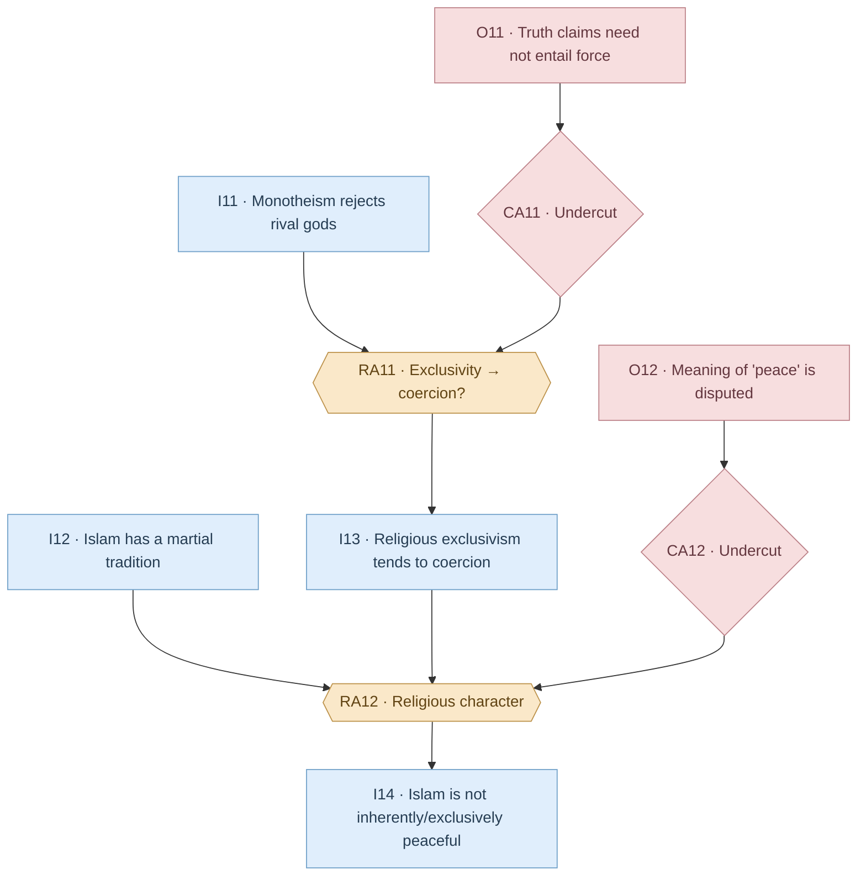
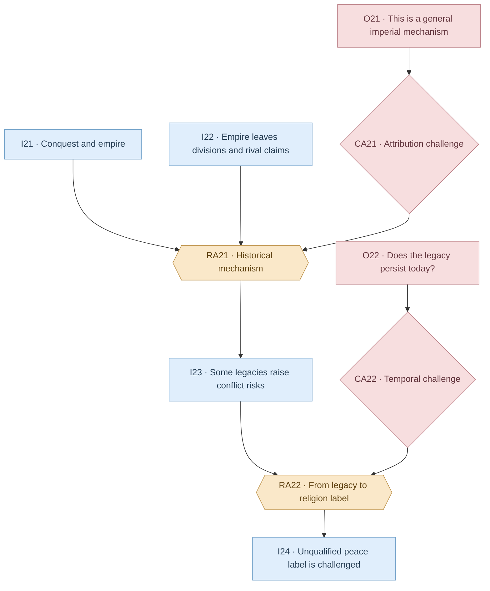
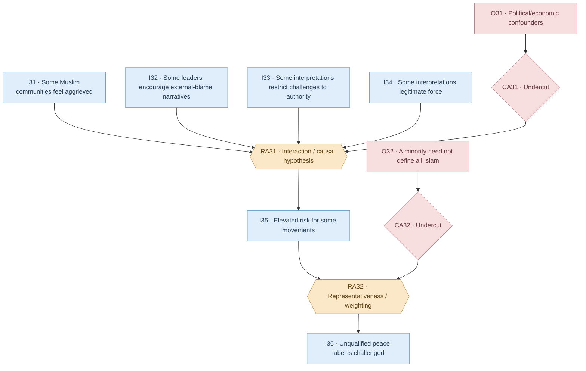

# HA1–HA3 — How do doctrine, history, and contemporary grievance affect Islam's character?

> [!abstract] Central issue
> Hirsi Ali proposes three connected explanations for why the motion **“Islam is a religion of peace”** should be rejected: (1) **theological exclusivism and martial precedent**, (2) **conquest and imperial legacies**, and (3) a **contemporary interaction between perceived victimhood and religious absolutism**. Each raises a different question about the relation between religious teachings, historical violence, present-day conflict, and how an entire religion should be classified.

## 0. Conventions and scope

- **[Q] Quoted:** short excerpts from Hirsi Ali's opening in the supplied speaker-labelled transcript (**Speaker F**, opening statement; local transcript line 15, plus the concluding interruption at line 17). Quotations preserve the supplied transcription, which may contain speech-recognition mistakes.
- **[R] Reconstructed:** explicit or implicit propositions formulated to make her reasoning testable; **not** necessarily endorsed verbatim by Hirsi Ali.
- **[O] Objection:** the analyst's challenge or alternative interpretation, **not** a statement by Hirsi Ali.
- **[E] External evidence:** an independent source consulted to test a factual or scholarly claim. Distinguish verification of *what she said* from verification of *whether it is true*.
- **[S] Suggested strengthening:** a more defensible version we could offer to a speaker, not a correction we silently attribute to her.
- **Evaluation statuses:** `stated`, `implicit`, `partially supported`, `contested`, `not established`, `requires verification`.

**Scope:** HA1–HA3 reconstruct arguments from the *opening statement*, not her later exchanges about Quranic verses, apostasy, women, and reform. Her claim that she had **two further factors** she did not reach because of time is noted, but those unspecified factors are **not** invented here. Other later claims may be linked in future notes.

> [!important] Three distinct target questions
> 1. **Conceptual / theological:** Can monotheistic exclusivity be reconciled with a “religion of peace”? (`HA1`)
> 2. **Historical / causal:** What did conquest and imperial inheritance contribute to conflict? (`HA2`)
> 3. **Explanatory / contemporary:** Does grievance plus absolutism help generate present-day conflict? (`HA3`)
>
> A successful argument on one question does **not** automatically settle the other two, nor does it automatically justify an unqualified classification of Islam as a whole.

## 1. Source extracts and margin comments

> [!quote] Ayaan Hirsi Ali — opening statement, selected extracts
> **[Q1 — Monotheism]** “no Monotheistic religion can be a religion of peace.”
>
> **[Q2 — Historical coexistence]** “Monotheistic religions know periods, lengthy periods of peace, but they also know lengthy periods of war.”
>
> **[Q3 — Jihad]** “there's the concept of jihad”; she describes it as “central to Islam's conquests and Islam's success.”
>
> **[Q4 — Imperial legacy]** “that legacy is the thrusting together of people of different ethnicities, languages, et cetera.”
>
> **[Q5 — Conflict likelihood]** “even if that empire declines the likelihood, the likelihood of conflict of war is probable. It's high, especially where there is a fault line.”
>
> **[Q6 — Victimhood]** “a minority who believe that Islam is under siege.”
>
> **[Q7 — Attribution]** “A mentality of victimhood tells those who are conquered, who are vanquished that the problem was caused by external powers, not by us.”
>
> **[Q8 — Absolutism]** “you can never revise or reflect on the Quran ... you can only follow his [Muhammad's] example.”
>
> **[Q9 — Interaction]** “That absolutism combined with that status of victimhood is also enlarges the likelihood of ... conflict.”

> [!note] Margin comments
> - **Q1–Q2:** The claim of *logical incompatibility* is stronger than the empirical claim that monotheistic traditions have histories of warfare. She moves between them without specifying what “religion of peace” must exclude.
> - **Q3:** Jihad is a complex historical and interpretive category. Its role in historical warfare is relevant, but its meaning and priority are not established merely by mentioning it.
> - **Q4–Q5:** This is a proposed causal mechanism, not simply an enumeration of historical battles. It may apply to *empires generally*, not Islam uniquely.
> - **Q6:** She says **a minority** believe Islam is under siege. Do not replace this with “most Muslims have a victimhood mentality.”
> - **Q8:** “Cannot revise the Quran” (fixing canonical text) and “cannot reflect on / interpret the Quran” (prohibiting interpretation) are **different propositions**. Her formulation conflates or moves between them.
> - **Q9:** HA3 concerns an *interaction of risk factors* and “likelihood,” not a stated law that everyone with these beliefs must engage in conquest.

## 2. Standard form — three related arguments

### HA1 — Religious exclusivism, jihad, and the character of Islam

1. **HA1-P1 [Q]:** Monotheistic religions assert the exclusive truth or authority of one God and reject rival divine claims.
2. **HA1-P2 [R, implicit, disputed]:** This kind of religious exclusivism involves a tendency or obligation to **suppress competing religious communities**, not merely to reject their beliefs.
3. **HA1-P3 [Q]:** Islam's historical tradition includes jihad and military campaigns associated with its founder and early expansion.
4. **HA1-P4 [R, implicit]:** These teachings and historical precedents remain sufficiently authoritative or important to the religion to affect its overall character.
5. **HA1-W1 [R, implicit]:** A religion containing authoritative grounds for coercion or war cannot accurately be called a “religion of peace,” at least under a demanding definition.
6. **HA1-C [R]:** Islam cannot straightforwardly be characterized as inherently or exclusively peaceful.

**Gap HA1-A:** From “only one God is true” it does **not** deductively follow that “adherents must attack believers in other gods.” Distinguish **truth exclusivity**, **social intolerance**, **political coercion**, and **armed violence**.

**Gap HA1-B:** The presence of violence in doctrine/history defeats *absolute pacifism*, but it does not by itself defeat the weaker claim “peace is a central ideal” or the sociological claim “most followers are peaceful.”

**Evidence point:** Hirsi Ali also asserts that Muhammad personally conducted **65 successful campaigns**. Treat that number as an **unverified historical assertion**, not as a premise already demonstrated. Historical sources distinguish expeditions personally led from missions commissioned and battles involving actual fighting.

### HA2 — Historical conquest, empire, and enduring fault lines

1. **HA2-P1 [Q]:** Islam's historical growth involved significant military conquest and imperial rule.
2. **HA2-P2 [Q/R]:** Empire can bring heterogeneous populations under a shared political structure, sometimes by force.
3. **HA2-P3 [R]:** Imperial boundaries, unequal power, and the later collapse of imperial authority can leave political/cultural fault lines.
4. **HA2-P4 [R, empirical]:** These legacies make subsequent conflict more likely in at least some relevant settings.
5. **HA2-C1 [R]:** The imperial history associated with Islam has contributed to conflict risks, including after particular empires decline.
6. **HA2-W [R, implicit]:** A significant, continuing contribution to conflict undermines the unqualified description “religion of peace.”
7. **HA2-C2 [R]:** Therefore Islam should not be classified unreservedly as a religion of peace.

**Gap HA2-A:** This mechanism is plausible for many empires; **what makes it especially Islamic, as opposed to imperial, political, geographic, or nationalist?**

**Gap HA2-B:** Evidence of *historical impact* may be relevant to present institutions, but a conclusion about **current Islam** requires a specified time frame and demonstrated continuity. HA2 can also act as a *background condition for HA3*, rather than standing alone.

**Caution on Huntington:** Hirsi Ali invokes Samuel Huntington as an interpretive reference for civilizational fault lines. Huntington's “clash of civilizations” is a **contested explanatory theory**, not proof of her mechanism or empirical consensus. Empirical tests have reached differing findings, including several unsupportive results. [E]

### HA3 — Imperial decline, perceived victimhood, and absolutism

1. **HA3-P1 [Q]:** Declining or defeated Muslim empires and colonial experiences can contribute to a sense of humiliation, loss, or external grievance among **some** Muslims.
2. **HA3-P2 [Q]:** Some religious or political leaders exploit those grievances and attribute problems mainly to external powers.
3. **HA3-P3 [Q]:** Certain influential interpretations of Islam treat scriptural or prophetic authority as unchallengeable; Hirsi Ali describes this as *absolutism*.
4. **HA3-P4 [R, implicit]:** Some such interpretations provide precedents or justifications for coercion, militancy, or restoring former political dominance.
5. **HA3-W1 [R, causal hypothesis]:** Perceived collective grievance **combined with** an authoritative ideology that legitimates force may increase support for violent conflict, compared with either factor alone.
6. **HA3-C1 [R]:** This combination makes **some communities or movements** more susceptible to conflict.
7. **HA3-W2 [R, implicit, contested]:** If this pattern is sufficiently prevalent, influential, or central to an Islamic tradition, it is evidence against an unqualified “religion of peace” label.
8. **HA3-C2 [R]:** Islam should not be classified without qualification as a religion of peace.

**Gap HA3-A:** HA3-W1 is a **testable explanatory hypothesis**, not a deductive certainty. Support needs evidence about prevalence, radicalization, ideology, confounding, and the interaction between factors.

**Gap HA3-B:** Even if a minority holds grievance-based absolutist views, the link from that minority to the religion's *overall classification* still depends on **representativeness, institutional power, harm, or an explicit definition** of the motion.

**Avoid exaggerating her conclusion:** Your phrase “must take the path of conquest” is stronger than what she says at this point. She argues for an **increased likelihood of conflict**, not inevitability or universal mobilization.

### How the three relate

- **HA1** supplies a claimed **ideological/doctrinal enabling condition** (and a conceptual attack on an absolute understanding of “peace”).
- **HA2** supplies **historical precedent and inherited background conditions**; part of it also supports the grievance context in HA3.
- **HA3** supplies a **proposed mechanism for contemporary conflict**, combining grievance with an allegedly rigid and sometimes militant reading.
- None separately proves that **most present-day Muslims are violent**. The overall conclusion depends on which meaning of “religion of peace” is being tested.

## 3. Toulmin reconstruction

| Component | HA1 — Monotheism and jihad | HA2 — Conquest and empire | HA3 — Victimhood and absolutism |
|---|---|---|---|
| **Claim** | Islam cannot be described as unqualifiedly peaceful. | Its imperial legacies make conflict more likely and trouble the peace label. | Certain contemporary Muslim movements face elevated risk of conflict. |
| **Grounds** | Religious exclusivism; jihad; reported military history of Muhammad and early Islam. | Conquest, heterogeneous empires, collapse, fault-line disputes. | Perceived humiliation; leaders' external-blame narratives; alleged religious absolutism. |
| **Warrant** | Authoritative coercive/violent content is incompatible with the relevant sense of “religion of peace.” | A tradition's historically caused and continuing conflict counts against its present character. | Grievance plus a violence-legitimating authority can increase conflict risk. |
| **Backing** | Would require textual/theological and historical analysis; not established by one number or a universal claim about monotheism. | Comparative imperial history; causal tracing; evidence that religious identity adds explanatory power. | Surveys, theological analysis, radicalization studies, longitudinal/comparative data. |
| **Qualifier** | Hirsi Ali speaks categorically; defensible narrowing: *not exclusively pacifist*. | Historical *risk* and *some contexts*, not universal inevitability. | *Some groups*, *conditional increased risk*, not a general claim about all Muslims. |
| **Rebuttal / exception** | Non-coercive monotheisms; interpretive diversity; peaceful injunctions. | Peaceful imperial legacies; nonreligious causes; change through time. | Grievance without violence; absolutism without militancy; successful counter-extremism. |

**What Toulmin exposes:** Her **warrants**, especially the rules for going from *some violent elements* or *some high-risk movements* to an overall religious label, are the main unresolved inferential bridges.

## 4. AIF-inspired argument graphs

**Design principle:** Distinguish **I-nodes** (propositions), **RA-nodes** (inferences), and **CA-nodes** (conflicts/undercutters). Put the criticism on the *specific inferential transition* where possible. These Mermaid diagrams are readable analytical maps, **not valid AIFdb serializations**.

### HA1 — Logic of exclusivism and classification



- **RA11:** a proposed *causal/ideological inference*, **not** deductively valid without a coercion premise.
- **RA12:** *defeasible classification from doctrinal/historical features*; depends on the criterion for “religion of peace.”

### HA2 — Conquest, empire, and conflict



### HA3 — Conditional interaction, not inevitability



> [!note] Linking the three graphs
> Link `HA2:I23` (imperial legacy) to `HA3:I31` (grievance-generating background), **but not as an automatic implication**. A further inference must establish that particular historical legacies produced today's attitudes. `HA1:I12` (martial tradition) may contribute to `HA3:I34` (legitimating force), but this too requires interpretive evidence.

## 5. Premise and inference classifications

### Proposition types

| Proposition | Type | How justified, if at all? | Status |
|---|---|---|---|
| Monotheism rejects other divine claims | Theological / definitional | Definition and historical practice | Broadly descriptive, but oversimplifies variety |
| Exclusivity entails coercion | Causal + normative bridge | None demonstrated in opening | Implicit / contested |
| Jihad was involved in historical expansion | Historical / interpretive | Primary sources and historiography | Broad historical issue; meanings and scope contested |
| Muhammad conducted 65 successful campaigns | Precise historical assertion | None cited in the opening | **Requires verification** |
| Empire brings heterogeneous groups together | Historical / sociological | Historical comparison | General mechanism; case-specific |
| Imperial fault lines raise later conflict risk | Causal / predictive | Comparative conflict evidence | Plausible hypothesis, disputed strength |
| Some Muslims feel under siege | Empirical claim about attitudes | No representative survey in opening | Explicitly minority; prevalence unknown |
| Leaders externalize blame | Psychological / political interpretation | Would require discourse/historical evidence | Stated mechanism; unquantified |
| Islam prevents revising or reflecting on its texts | Theological / institutional | Requires identification of traditions and authorities | **Too broad without qualifications** |
| Grievance + absolutism increases conflict | Causal interaction hypothesis | Comparative and longitudinal evidence | **Not established by opening** |
| Islam is not a religion of peace | Evaluative / classificatory | Depends on criterion, severity and representativeness | Disputed conclusion |

### Inference types and argumentation schemes

| RA-node | Broad reasoning type | Scheme / family | Critical questions |
|---|---|---|---|
| RA11 | Conceptual / causal, defeasible | Custom: exclusivity → coercion | Does denying another deity actually prescribe violence? Under what conditions? |
| RA12 | Defeasible evaluative inference | Custom: classification from doctrinal features | How central, authoritative, and contemporary must a feature be? |
| RA21 | Abductive / causal | Causal explanation from historical process | Are fault lines caused by religious legacy, empire, state-building or other factors? |
| RA22 | Defeasible classification | Custom: historical legacy → present character | Has the mechanism persisted? Is past conduct sufficient? |
| RA31 | Abductive / probabilistic causal hypothesis | Interaction of grievance + ideology | What alternative causal explanations exist? Are both factors necessary? Evidence of interaction? |
| RA32 | Defeasible evaluative generalization | Custom: risk in subgroups → aggregate label | Is the group representative or sufficiently influential? What is the decision rule? |

**About Walton:** A few steps resemble Walton-style *causal reasoning* or *argument from consequences*, but a scheme label is not a substitute for specifying the premises and critical questions. These are **analyst-assigned classifications**, not claims that Walton formally catalogued these exact custom schemes. “Abductive” describes explaining observed conflict with candidate causes; it does not mean the hypothesis is already the best explanation.

## 6. Objections and alternative interpretations (targeted register)

| ID | Your objection / refinement | Target | Attack type | What would address it? |
|---|---|---|---|---|
| O1 | Exclusive truth need not involve military defeat of other faiths. | HA1 RA11 | **Undercutter** of inferred coercion | Cite norms/institutions commanding force, distinguish from simple exclusivity. |
| O2 | Islam has peaceful and violent messages; perhaps “both,” “mixed,” or “neither” is better. | HA1 RA12 + motion definition | **Alternative classification** | Define peace as pacifism, primary teaching, typical effect, legitimate limits on force, etc. |
| O3 | Believers may depart from founder/scripture; does that make their religion incoherent? | HA1 RA12 / `[[ZK1]]` RA1 | **Conceptual question** | Distinguish normative ideal of fidelity from descriptive diversity of practiced religion. |
| O4 | Empire dynamics appear in secular and other religious settings; why isolate Islam? | HA2 RA21 | **Causal attribution challenge** | Compare other empires, control for power, geography, institutions, wealth, nationalism. |
| O5 | The past may be only background. How does it affect Islam now? | HA2 RA22 | **Temporal undercutter** | Trace continuing doctrines, institutional rules, conflicts and political narratives. |
| O6 | Huntington is a theory, not proof; does its evidence generalize? | HA2 P4 / RA21 | **Appeal-to-theory scrutiny** | Assess explicit predictions and empirical comparative tests. |
| O7 | Victimhood is experienced by minorities / particular movements, not Islam as a whole. | HA3 RA32 | **Representativeness challenge** | Measure prevalence and political reach; use population- and institution-specific conclusions. |
| O8 | Are “absolutism” and violent restoration actually linked? | HA3 P3–P4 / RA31 | **Missing causal bridge** | Separate scriptural inerrancy, interpretive rigidity, political theocracy and violent militancy. |
| O9 | If religious characteristics were absent, would grievance still generate conflict? | HA3 RA31 | **Counterfactual / confounding** | Compare otherwise similar communities or movements differing in ideology; specify counterfactual. |
| O10 | Are religions best judged by worst tendencies, dominant tendencies or foundational principles? | HA1/HA2/HA3 RA12/22/32 | **Classification-rule challenge** | State explicit weighting/threshold for the motion. |
| O11 | Her case argues “not exclusively peace,” but does it justify “a religion of war”? | Final conclusion | **Scope / false dichotomy** | Distinguish `not always peaceful` from `primarily promotes war`. |
| O12 | Comparing modern nonmilitary migration to historical conquest may distort both. | Analyst's suggested extension | **Analogy / conceptual challenge** | Do not add this premise to HA2 without explicit evidence and independent standards. |

> [!warning] Two places to tighten your interpretation
> - Your suggestion that the **teaching and the effect on followers “logically should be the same”** is a philosophical expectation, not a logical necessity. People interpret selectively and are influenced by other causes; a doctrine may even have conflicting teachings.
> - HA3 is **not fully “logically sound” as stated**, because the step from grievance and religious authority to *increased violence* is an unproven causal hypothesis. The structure is intelligible and potentially reasonable, but **logical validity**, *causal plausibility*, and *evidential support* should receive separate ratings.

## 7. Evidence and fact-check layer

| Claim or reference | Assessment | Evidence and limitation |
|---|---|---|
| Hirsi Ali said no monotheistic faith can be a religion of peace. | **Verified as a quotation.** | Not an established logical theorem or consensus finding. Some scholars argue monotheism's exclusivism can encourage violence, while others challenge the necessity of that link. [E1] |
| Jihad is connected to Islamic military history. | **Historically relevant but contested in meaning and application.** | Armed jihad has an important history; its interpretation and rules vary. The reference does not establish that conquest is the *only* or universally central meaning. [E2] |
| Muhammad led 65 military campaigns, “all successful.” | **Not verified; probably conflates categories.** | A classical narration in *Sahih al-Bukhari* gives **19** ghazawat for campaigns in which he took part; other historical tallies distinguish personally led expeditions from commissioned missions and actual battles. The speaker's **65** may refer to a different combination, but “conducted 65” and “all successful” should not be accepted as established without an itemized source. [E3] |
| Conquest and imperial decline can create fault lines. | **Plausible general causal mechanism; context-dependent.** | Needs specific historical case studies. The existence of empires and conflicts does not, on its own, identify Islam as the decisive cause. |
| Huntington's clash-of-civilizations claim is accurate. | **Contested.** | Some quantitative work finds little or no support; another analysis finds some period-specific association. Neither makes the narrower empire-to-fault-line-to-modern-Islam chain self-proving. [E4] |
| Islamic teaching forbids reflection or interpretation of Quran/Muhammad. | **Overgeneralized.** | Islamic jurisprudence has long traditions of *ijtihad* and disagreements over interpretive authority; constraints and scope vary by tradition and era. Canonical text being held sacred is **not** identical to uniform prohibition on interpretation. [E5] |
| “A minority” believe Islam is under siege. | **Verified as what she says; actual proportion unmeasured here.** | No survey/population baseline supplied in opening. Distinguish attitudes about geopolitical grievances from support for violence. |
| Victimhood + absolutism increases propensity for violence. | **Testable hypothesis; not established here.** | Requires defined exposures, outcomes, interaction tests, time ordering and plausible confounders. |
| Muslim societies fell behind because of internal religious flaws. | **Raised as rhetorical questions, not demonstrated in opening.** | She offers the scientific revolution comparison as a prompt to consider internal causes alongside external ones; do not recast it as a proved monocausal historical explanation. |

**External reading consulted** (links for later independent checking; these are external research, not material from the supplied transcript):

- **[E1]** [Yale *Reflections*: “Christianity and Violence”](https://reflections.yale.edu/article/violence-and-theology/christianity-and-violence), discussing claims about monotheism and the limits of exclusivism as a sufficient explanation of violence.
- **[E2]** [European Parliamentary Research Service, “Islamic jihadism” briefing (2015)](https://www.europarl.europa.eu/RegData/etudes/ATAG/2015/557007/EPRS_ATA%282015%29557007_EN.pdf), distinguishing interpretations and uses of jihad.
- **[E3]** [*Sahih al-Bukhari*, Book of Military Expeditions, hadith 3949](https://sunnah.com/bukhari/64/1); [Oxford University Press, *Muhammad's Military Expeditions* (2024)](https://academic.oup.com/book/57350/chapter/464642014), on differences in historical source categories.
- **[E4]** [*British Journal of Political Science*, “Ethnic Minorities and the Clash of Civilizations” (2002)](https://www.cambridge.org/core/journals/british-journal-of-political-science/article/abs/ethnic-minorities-and-the-clash-of-civilizations-a-quantitative-analysis-of-huntingtons-thesis/85A9699D564116ED2EC38FB0E4385B64); [*Journal of Peace Research*, “Is There a Clash of Civilizations?” (2002)](https://academic.oup.com/jpr/article-abstract/39/6/711/8366772); [“A Test of Huntington's Thesis” (2012)](https://www.degruyterbrill.com/document/doi/10.1515/peps-2012-0011/html), demonstrating mixed findings across empirical tests.
- **[E5]** [“Ijtihad in the RE classroom” (2024)](https://www.tandfonline.com/doi/full/10.1080/13617672.2024.2312337), discussing Islamic interpretive debates and ijtihad.

**Not completed:** a comprehensive review of primary Islamic scripture, the historical record of the various caliphates, contemporary violence datasets, or the causal role of religious doctrine in militant recruitment. The entries above are targeted checks, not a comprehensive verdict.

## 8. Logic and potential fallacies — conditional audit

| Issue | Location | Assessment |
|---|---|---|
| **Non sequitur / missing bridge** | “One God” → “must wage war” | Religious exclusivity does not logically necessitate military coercion. Would need additional ideology and practice premises. |
| **Possible equivocation** | “religion of peace” | Alternates between `never wages war`, `teachings oppose violence`, and `contemporary tendency toward peace`. These are not equivalent. |
| **Ambiguous negation** | “not a religion of peace” | Does not entail “a religion of war.” Mixed or conditional categories are possible. |
| **Overgeneralization** | All monotheisms are violent by nature | Historical episodes do not establish a universal necessity claim. |
| **Genetic / origin-to-present risk** | Founder/conquests → present religion | Origin is relevant to some questions, but historical origin alone cannot settle changing contemporary practice. It is not always fallacious; depends on claim. |
| **Confounding / attribution** | Empire → specifically Islamic conflict | Territory, state power, inequality, ethnicity and institutions may explain the same pattern. |
| **Appeal to theory / authority** | Huntington reference | A theory offers a model or prediction; name-checking it is not independent evidence. |
| **Unproved interaction** | Victimhood × absolutism | The hypothesis may be reasonable but lacks data showing independent or interactive effects. |
| **Composition / representativeness** | Minority high-risk movements → nature of whole religion | Invalid if a claim about subgroups is silently enlarged to all adherents; not automatically invalid if the motion means *any authoritative legitimation of violence*. |

**Use “potential” deliberately.** Many of these are **missing premises or measurement gaps**, not proof that the speaker committed a named formal fallacy.

## 9. Rhetorical layer

| Move | Opening context | Effect / risk |
|---|---|---|
| **Ethos through personal risk** | Mentions fearing for her life as a dissident. | Makes the stakes concrete, but testimony of threat is not a sample of an entire religion. |
| **Concession** | Praises Khan and acknowledges charity/prayer and long peaceful periods. | Signals fairness; allows her to argue that peace coexists with conflict. |
| **Definitional framing** | Defines religion and insists no monotheism is a religion of peace. | Moves debate from ordinary practice to underlying doctrine; risks locking in the answer through a demanding definition. |
| **Historical enumeration** | Muhammad's campaigns and imperial conquests. | Creates an impression of evidential weight; exact numbers and categories require verification. |
| **Appeal to named theory** | Huntington and “fault lines.” | Adds an explanatory framework; risks laundering a contested theory into evidence. |
| **Rhetorical questions** | Why did Muslim civilizations not lead the later scientific revolution? | Prompts consideration of internal causes; no historical causal answer is supplied. |
| **Cumulative causal framing** | Militarism + imperial legacy + victimhood + absolutism. | Suggests reinforcing mechanisms; requires attention to whether each mechanism is independent or merely repeating the same premise. |

Rhetorical force does not automatically indicate dishonesty or invalidity; track **function**, **fairness**, and **empirical support** separately.

## 10. Implicit values and priorities

- **Freedom of conscience and criticism:** Religious authorities and founders should be open to scrutiny.
- **Secular pluralism:** Different communities should coexist without coercive imposition of religious truth.
- **Accountability rather than exculpation:** Criticism should consider **internal religious ideas** as well as political and colonial context.
- **Attention to minority harms:** Even a small coercive minority can produce serious harm and suppress dissent.
- **Intellectual revisability:** The ability to question inherited doctrines is considered a virtue.
- **Countervailing values at issue:** Fair representation of peaceful believers, self-definition, avoiding stigma and preserving contextual nuance.

> [!note] Important classification distinction
> **“A religion should permit questioning its founders”** is a **normative value**, while **“a particular Islamic community punishes dissent”** is an **empirical proposition**. They should be represented as different I-node types even when used together in one argument.

## 11. Alternatives and what would establish each

| Alternative interpretation | What it concedes | What it challenges | What to examine |
|---|---|---|---|
| **Mixed-text / mixed-tradition account** | Islam contains traditions linked to both peace and violence. | Necessity of a binary label. | Authority/centrality of teachings, competing interpretations, moral criteria. |
| **Pacifism test** | Islam historically permits some warfare. | The conclusion *only if* peace is used as strict pacifism. | Whether the debate's motion really means “prohibits all war”; consistency across other religions. |
| **Doctrinal test** | Founders and canonical sources matter. | Using every historical episode as proof of timeless doctrine. | Scripture in context, jurisprudence, modern interpretive positions. |
| **Institutional test** | Interpretations influence laws and coercion. | Inferring institutional behavior from every believer's text. | Courts, educational and religious institutions, competing schools, state power. |
| **Contemporary prevalence test** | Violent minority movements exist. | Taking minorities as representative. | Surveys, prevalence, geographic variation, institutional influence. |
| **Causal effect test** | Ideology could affect violence. | Treating association as causation. | Historical controls, comparable movements, confounders, time ordering, counterfactuals. |
| **Conditional risk account** | Grievance and authoritarian interpretations may interact. | The claim that all Islam is inherently militant. | Mechanism-specific studies and estimated interaction effects. |

**Your football-hooliganism analogy** is useful *as a logical counterexample*: a social identity can be associated with violence without its defining activity requiring violence. Its limit is that religions can contain **normative instructions** and institutions, so a complete empirical comparison still needs to examine doctrine and authority. The analogy weakens a shortcut; it does not disprove all religious causal influence.

**Your representative-test idea** can be strengthened by separating two different decision rules:

1. **Typicality:** Does a movement represent the beliefs/actions of the median or overwhelming majority of Muslims?
2. **Authority and consequence:** Even if numerically small, does the movement express a recognized authoritative interpretation or control institutions sufficiently to shape rights and violence?

The answer to **(1)** may be “no” while the answer to **(2)** is “yes” in particular places. Neither answer by itself establishes the motion.

## 12. Cross-comparison with ZK1 — where the debate actually hinges

| Shared question | Khan `[[ZK1]]` | Hirsi Ali `HA1–HA3` | What would resolve it? |
|---|---|---|---|
| **How define Islam?** | Privileges lived interpretations and practice. | Privileges foundational tenets, history and authority. | Agree on a multidimensional definition instead of treating one dimension as exclusive. |
| **Who represents Islam?** | Peaceful majority should not be defined by radicals. | Important or authoritative violent interpretations still count. | Specify whether prevalence, authority, impact, or normative doctrine is the chosen criterion. |
| **How interpret texts?** | Mixed passages invite lived contextual interpretation. | Foundational claims and martial precedents remain serious problems. | Textual analysis and evidence about interpretation, institutional authority and conduct. |
| **How explain violence?** | The related `[[ZK2]]` emphasizes politics rather than piety. | HA3 gives politics/historical grievance and religious absolutism an interacting role. | Test competing *causal models*, including interactions and confounders. |
| **Temporal scope?** | Contemporary majority practice. | Early history + lasting legacies + contemporary movements. | Decide whether motion is historical, contemporary or universal. |

> [!important] A notable possible agreement
> Khan and Hirsi Ali both recognize peaceful contemporary Muslims and political motivations. They differ much more in **how to weigh texts, religious authorities, historical precedents, and present adherents**, and **whether religious ideas contribute independently to violence**. Their dispute is not simply “peaceful people exist” versus “violent people exist.”

## 13. How to strengthen HA1–HA3 charitably

> [!example] Suggested narrower formulation (not Hirsi Ali's wording)
> Islam, like other long-lived religions, includes historically influential traditions that have justified armed conflict as well as teachings and practices that support peaceful coexistence. Its political and imperial history has also shaped some modern conflicts. In certain movements, perceived collective humiliation may interact with rigid interpretations of religious authority to legitimize violence. These considerations make an **unqualified, exclusively pacifist characterization** of Islam difficult to defend. They do not establish that most Muslims are violent or that Islam alone explains contemporary conflict.

**What this repairs:**

1. Eliminates the unsupported rule **monotheism necessarily causes violence**.
2. Distinguishes historical facts from the *current* contribution of religious interpretation.
3. Treats HA3 as a **conditional, testable risk mechanism**.
4. Avoids turning a **minority** into a claim about **all Muslims**.
5. States a narrower conclusion that the presented grounds could plausibly support.

**What still must be shown to refute the original motion:** a defensible meaning of “religion of peace” under which the sources, institutional practices and prevalence/impact of violent interpretations are sufficiently important to outweigh other features. An argument against *strict pacifism* alone may not defeat the motion as commonly understood.

## 14. Provisional assessment and reusable data schema

> [!summary] Provisional assessment
> - **HA1:** Powerful as a challenge to *absolute pacifism*, but its strongest claim (“no monotheism can be peaceful”) lacks the premise connecting exclusivity to violent enforcement.
> - **HA2:** Provides genuine historical and causal questions, but must separate **general imperial mechanisms** from specifically Islamic causes and demonstrate their contemporary significance.
> - **HA3:** Arguably the most interesting explanatory hypothesis: an **interaction between grievance narratives and rigid authority claims**. Her opening does not provide the evidence needed to establish its size, prevalence or relation to violence.
> - **Across all three:** **The definition and weighting rule for “religion of peace”** remains a shared unresolved hinge with `[[ZK1]]`.

### Suggested collaborative research checkpoints

- [ ] Establish what counts as **peace**: pacifism, nonaggression, tolerance, prosocial behavior, or another operational target.
- [ ] Distinguish religion's **doctrine, historical institutions, practice, and causal effect**.
- [ ] Source-check the claimed **65 campaigns** with clear expedition/battle categories.
- [ ] Identify which **jihad** interpretations and historical episodes the argument actually relies on.
- [ ] Evaluate Huntington's claims against comparative conflict research rather than citing the name alone.
- [ ] Examine Islamic **ijtihad** and restrictions on authority: sacredness of a text is not identical to an absence of interpretive debate.
- [ ] Find contemporary evidence on **victimhood narratives, religious rigidity and support for political violence**, with country/time stratification.
- [ ] Build rival causal explanations and examine **counterfactuals / confounders**.
- [ ] Apply both **typicality** and **authority/impact** tests before making religion-wide claims.
- [ ] Link objections to **RA-nodes** wherever they challenge an inference, not a factual claim itself.

### Illustrative schema (not standardized AIF)

```yaml
speaker: Ayaan Hirsi Ali
source: opening_statement
arguments:
  - argument_id: HA1
    target_claim: I14
    premise_nodes: [I11, I12]
    inference_nodes:
      - {id: RA11, type: causal, scheme: custom_exclusivity_to_coercion}
      - {id: RA12, type: defeasible, scheme: custom_doctrinal_classification}
    challenges:
      - {id: O11, relation: undercut, target: RA11}
      - {id: O12, relation: undercut, target: RA12}
  - argument_id: HA2
    target_claim: I24
    premise_nodes: [I21, I22]
    inference_nodes:
      - {id: RA21, type: causal_explanatory, scheme: historical_causal_mechanism}
      - {id: RA22, type: defeasible, scheme: custom_legacy_to_present_character}
    challenges:
      - {id: O21, relation: undercut, target: RA21}
      - {id: O22, relation: undercut, target: RA22}
  - argument_id: HA3
    target_claim: I36
    premise_nodes: [I31, I32, I33, I34]
    inference_nodes:
      - {id: RA31, type: abductive_causal, scheme: custom_grievance_authority_interaction}
      - {id: RA32, type: defeasible, scheme: custom_subgroup_to_classification}
    challenges:
      - {id: O31, relation: undercut, target: RA31}
      - {id: O32, relation: undercut, target: RA32}
cross_argument_links:
  - {from: HA2_I23, to: HA3_I31, relation: proposed_historical_support, needs_evidence: true}
  - {from: HA1_I12, to: HA3_I34, relation: proposed_interpretive_support, needs_evidence: true}
shared_unresolved_issue: definition_of_religion_of_peace
status: unresolved
```

**Methodological warning:** This schema and its Mermaid pictures are **analytical conveniences**. A formal AIF implementation requires explicit edge typing and compatible scheme-node constraints. Importantly, avoid treating the *analyst's conjectures* about the speaker as direct quotation or fact.
