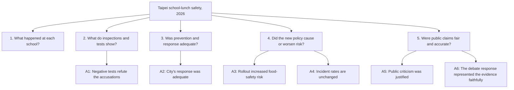

# Taipei school-lunch safety (2026): What can we conclude?

> [!abstract] Start here · 90-second reading
> **The issue:** Taipei introduced universally funded lunches for elementary and junior-high students at the start of the 2026–27 school year. Several schools subsequently reported students feeling unwell. One school meal **was confirmed contaminated**; other investigated meals or ingredients **tested compliant**. The resulting disagreement concerns what these findings prove about food safety, government oversight, and political criticism.
>
> **Established:** A retained meal from **成淵高中國中部 (Chengyuan)** contained *Staphylococcus aureus* enterotoxin B; 87 students had reported diarrhea, and the city fined the contractor NT$180,000. [[#Sources|S1–S2]]
>
> **Also established:** On October 7, the city said six *other tested school meal samples* complied with the applicable rules. **This did not retest the original September 4 meal at 金華國中 (Jinhua)**, which was no longer retained. [[#Sources|S3–S5]]
>
> **Not established:** That the new *free-lunch financing policy* caused the contamination; that all reported illness clusters came from school meals; that all suspicions were fabricated; or that oversight was adequate or inadequate *overall*.
>
> **Reading principle:** A confirmed incident, a negative sample, an unanswered question, and an accusation of dishonesty are four different propositions.

**Choose your path**
- **2 minutes:** Read this introduction, [incident table](#the-incidents-do-not-form-one-case), and [provisional findings](#provisional-findings).
- **10 minutes:** Read the [issue questions](#the-issue-tree), [evidence table](#what-the-evidence-can-and-cannot-show), then expand 1–2 argument cards.
- **30+ minutes:** Expand all [argument cards](#argument-cards-optional-deep-dive), inspect their sources, and try the [reader exercise](#reader-exercise).

> [!info] How to use this note
> This is an **issue map**, not a verdict on a candidate or a motion to vote on. The main entry point is a *question*. Claims appear **inside** that issue when someone makes an inference that needs evaluation. Expand the callout arrows only where you want more detail. Source labels (S1, S2, ...) link to a source directory at the bottom.

## The issue tree

**Entry question:** *How well did Taipei's school-lunch safety arrangements work during the early rollout of universally funded lunches?*

> [!question]- Why not begin with the claim “The Taipei government acted adequately”?
> Because that question joins **different standards**: an outbreak can be real even if the response is prompt; a test can be valid even if the sample is not from the disputed day; a policy can be beneficial even if a contractor violates hygiene rules. These are connected but not interchangeable. Readers can enter through the incident, the testing, the policy, or the political exchange, and arrive at specific assessable claims.

>[!Question]- Maybe what we need is a methodology to come up with this issue tree?
> How this could affect the framing of the analysis?
## Essential background

- **Policy change:** From **August 31, 2026**, Taipei began paying for standard lunches for covered elementary and junior-high students. Previously families generally paid, with targeted subsidies; schools already used a mix of cooking and supplier arrangements. This was **not** the creation of a brand-new centralized city kitchen system. The city said the per-meal value could reach **NT$87 (elementary)** and **NT$92 (junior high)**, with an annual budget around **NT$3.6 billion**, covering about **186,000 students**. [[#Sources|S6]]
- **Why it matters:** Public funding, meal quality, procurement capacity, infection control, investigation procedures and government communication are separable policy dimensions.
- **Three distinctions:** (i) *symptoms* versus *confirmed food contamination*; (ii) *sample from the suspected meal* versus *a later sample or shared ingredient batch*; (iii) *supplier responsibility* versus *citywide policy causation*.

>[!missing] Is there a planned brand-new centralized city kitchen system?

## The incidents do not form one case

| School / date                                          | Reported illness                                                                                    | What later evidence established                                                                            | Important limit                                                                                                       |          |
| ------------------------------------------------------ | --------------------------------------------------------------------------------------------------- | ---------------------------------------------------------------------------------------------------------- | --------------------------------------------------------------------------------------------------------------------- | -------- |
| **成淵高中國中部** · Sept 7                                   | 87 students reported diarrhea after eating school food                                              | Retained lunch contained *S. aureus* enterotoxin B; contractor fined NT$180,000; school contracts affected | Confirms contamination in that meal, **not** that free-lunch financing caused it [[#Sources                           | S1–S2]]  |
| **金華國中** · suspected Sept 4; publicly disputed Sept 23 | Councillor alleged a broader cluster; city said it confirmed **3 students with differing symptoms** | A sample of the **same squid ingredient batch** was compliant; later lunch samples were compliant          | **Original Sept 4 prepared lunch was not available** for laboratory testing; the scale itself was disputed [[#Sources | S3–S5]]  |
| **景興國小** · Sept 23                                     | Multiple students reported unwell                                                                   | Sampled food passed reported inspection                                                                    | Negative food test does not necessarily diagnose the students' illness [[#Sources                                     | S3–S4]]  |
| **民族國小** · Sept 24                                     | Students reported gastrointestinal symptoms                                                         | Sampled food passed; authorities considered gastrointestinal / viral illness                               | Exact transmission route not demonstrated by a negative food sample alone [[#Sources                                  | S3–S4]]  |
| **延平中學** · Oct 7                                       | Approximately 21 reported symptoms                                                                  | Meal sample found compliant; the result was communicated to the school in October                          | This result was subsequently clarified in a **Nov 3 correction** to a fact-check [[#Sources                           | S4]]     |
| **天母國中** · Oct 15                                      | 8 of 1,394 lunch recipients reported symptoms, mainly mouth tingling/itching                        | The **Oct 15 retained lunch** was compliant                                                                | Source of symptoms not conclusively established by the reported food test [[#Sources                                  | S4, S8]] |

> [!warning] Counting trap: two different groups of “six schools”
> - **Six schools tested in the Oct 7 city announcement:** 金華、景興、民族、健康、敦化、三民. The last three were included because they shared a preparation/supply group. **成淵 was not in this set.** [[#Sources|S3]]
> - **Six schools with suspected incidents discussed in the Nov 3 fact-check:** 成淵、金華、景興、民族、延平、天母. **These are not the same six schools.** [[#Sources|S4]]
> Statements about “six schools passing” and “six schools reporting incidents” must not be substituted for one another.

>[!missing] How are these incident rate compare to pre-universally funded lunch?

### Short timeline

| Date                | Development                                                                                                                            | Source |
| ------------------- | -------------------------------------------------------------------------------------------------------------------------------------- | ------ |
| **Aug 31**          | Universal funding begins                                                                                                               | S6     |
| **Sept 7–8**        | Chengyuan illness and initial inspection; five hygiene deficiencies reported                                                           | S1, S2 |
| **Sept 18**         | Chengyuan retained meal tests positive; contractor fined, contracts terminated                                                         | S1     |
| **Sept 23–24**      | Jinhua allegations publicized; education department disputes number and causal characterization                                        | S5     |
| **Oct 7**           | City announces compliant samples from six inspected schools                                                                            | S3     |
| **Oct 15 / Oct 30** | Tianmu symptoms / compliant retained-lunch result reported                                                                             | S8     |
| **Oct 31**          | Chiang Wan-an and Shen Bo-yang exchange claims about safety and city operating procedures in televised debate                          | S7     |
| **Nov 3**           | Taiwan FactCheck Center updates its assessment, including clarification of Yanping test status                                         | S4     |
| **Nov 6**           | Chengyuan compensation arrangements reported: NT$400–4,000 depending on the circumstances; city discusses further improvement measures | S9     |

## What the evidence can and cannot show

| Evidence or observation | Supports | **Does not by itself support** |
|---|---|---|
| Positive toxin finding in Chengyuan retained lunch | That the sampled lunch was contaminated; reason for enforcement action | Claim that every school lunch was unsafe or the new funding model caused contamination |
| Negative tests on inspected meals | That **those samples**, for tested criteria, met relevant requirements | Guarantee that all meals from every day were safe, or that symptoms were fabricated |
| Negative test on a shared squid batch | Some reassurance about the sampled ingredient batch | Proof that the **prepared September 4 Jinhua meal** was safe after cooking, storage and service |
| Original Jinhua meal unavailable after retention period | Why direct retrospective testing was impossible | Proof of concealment, contamination, or an otherwise improper destruction |
| Procurement tenders finished unusually late in August | Operational pressure at launch | Causal link to a specific microbial contamination event |
| One confirmed contamination event near rollout | Safety failure in one supplied meal | Whether the **rate of outbreaks per meal** increased versus earlier years |
| 2025 city table: 8 incidents / 67 patients at **school locations** | A contextual historical statistic | A matched before/after school-*lunch* rate: category, period and denominators differ [[#Sources|S10]] |

## Provisional findings

**What appears established (as at Nov 7, 2026):**
1. A genuine food-safety failure occurred at Chengyuan; city sanctions and later compensation followed.
2. Several subsequent food or ingredient samples were compliant, but the original Jinhua meal could not be directly tested.
3. Taipei's free-lunch funding rollout and schools' food preparation/contracting system are related but **not identical**; the new policy's causal role in the outbreak remains unproven.
4. The debate contains disagreements not just about facts, but about the **strength of inference** that can reasonably be drawn from them.

**What remains open:** Whether existing oversight could reasonably have prevented Chengyuan; whether the city's communication consistently preserved test-sample limitations; whether increased procurement pressure materially changed food safety; and how comparable pre/post incident rates would look after standardization.

---

# Argument cards (optional deep dive)

*Each expandable card uses the same layers: claim → supporting reasoning → objections / alternative interpretation → hidden assumptions → evidence needed → reasoning or rhetorical patterns. These are **analytical reconstructions**, not quotations attributed to either candidate unless noted.*

> [!example]- **A1 · Claim: “The negative lab results show the school-lunch accusations were unfounded.”**
> **Type:** Empirical / interpretive · **Status:** Overbroad if applied to *all* incidents.
>
> **Supporting argument (standard form)**
> 1. City officials reported compliant results for six inspected schools' lunch samples (S3).
> 2. Noncompliant food would sometimes be detectable by laboratory testing.
> 3. Therefore, these results reduce concern that the **specific sampled foods** were contaminated.
>
> **Where the inference goes too far**
> - Chengyuan's **different** retained lunch tested positive (S1).
> - At Jinhua, the September 4 cooked lunch itself was not available; the later meal sample and shared ingredient batch cannot answer every question about preparation that day (S4–S5).
> - A false causal inference by a critic is not automatically a knowingly fabricated accusation.
>
> **Implicit assumptions to inspect:** Were samples from the correct date and population? Was the test sensitive to the plausible hazards? Does a finding of compliant food rule out all foodborne illness mechanisms? Is “unfounded” being used to mean *not proved* or *disproved*?
>
> **Alternative, narrower conclusion:** “The tested samples passed; no laboratory evidence from those samples establishes food contamination.”
>
> **Would change this assessment:** Identification of preserved original meals or persuasive epidemiology establishing / excluding a common meal-linked cause.
>
> **Argumentation patterns:** Scope shift; sample-to-population inference; *absence of evidence* confused with *evidence of absence*; ambiguity between “unverified” and “false.”

> [!example]- **A2 · Claim: “The city government's response to these incidents was adequate.”**
> **Type:** Evaluative, incorporating empirical facts · **Status:** Requires an explicit benchmark.
>
> **Supporting argument (standard form)**
> 1. Following Chengyuan's report, authorities inspected and sampled, suspended the relevant operation, imposed a fine after contamination was found, ended affected contracts, and arranged alternative service / claims support (S1–S2).
> 2. After other reports, the city conducted inspections, testing and follow-up (S3, S8).
> 3. These are relevant components of a responsible response.
> 4. **Therefore**, it has evidence of substantial *responsive action*.
>
> **Objections**
> - Responsive action is not the same as adequate **prevention**; inspectors found hygiene deficiencies both at Chengyuan and in six other checked kitchens (S2, S11).
> - Adequacy depends on response speed, prior warning signs, risk-based oversight, communication and follow-through, not just a checklist of actions performed.
> - The existence of later improvement measures can signify learning, but neither proves prior negligence nor erases it.
>
> **Hidden normative premises:** What level of risk is acceptable for public school meals? Is compliance with written procedure enough, or should government detect predictable failures in advance? How much transparency is owed before definitive results exist?
>
> **Would change this assessment:** Pre-incident inspection histories; detailed incident timelines; comparison with applicable SOP and professional guidance; evidence that corrective actions reduced recurring risks.
>
> **Argumentation patterns:** Equivocation between *acted* and *acted adequately*; confusing ex-post remedies with ex-ante prevention; judgment depends on an unstated standard.

> [!example]- **A3 · Claim: “Making lunches free caused or increased food-safety problems.”**
> **Type:** Causal · **Status:** Not established by timing alone.
>
> **Possible argument**
> 1. The city changed funding and procurement requirements at the start of the school year (S6).
> 2. Procurement was unusually late: the fact-check reports that all tenders were completed only by late August (S12).
> 3. A major contamination event occurred soon after launch (S1).
> 4. Hence, the policy may have created operational stress that increased risk.
>
> **Objections / alternative explanations**
> - Schools used kitchens and contractors before free lunches; being free is not itself a contamination mechanism.
> - The Chengyuan contamination could stem from local food handling irrespective of new financing.
> - Schools and catering suppliers might also benefit from **higher per-meal budgets** and stronger oversight.
>
> **Hidden causal chain (must be tested):** New subsidy / procurement rules → reduced competition or rushed contracting → weaker food handling / inspection → contamination.
>
> **Would change this assessment:** Evidence on contract changes, contractor staffing, workload, inspection trends, meal volumes, food temperatures and matched rates of contamination before vs after launch.
>
> **Argumentation patterns:** Post hoc reasoning; correlation vs causation; mechanism missing between policy and outcome.

> [!example]- **A4 · Claim: “Food-poisoning rates stayed roughly unchanged after free lunches began.”**
> **Type:** Quantitative empirical · **Status:** Currently indeterminate.
>
> **Potential support:** The official 2025 statistical table reports **8 incidents and 67 patients at school locations** (S10). School-associated foodborne illness existed before the reform.
>
> **Problem:** The historic category includes events at school *locations*, rather than only supplied lunches; 2026 incident reports mix suspected cases, confirmed contaminants and schools tested; the post-implementation period is short; no comparable *meals served* denominator has been established.
>
> **Correct comparison would require**
> - Same case definition (suspected vs confirmed; school lunches specifically)
> - Same time window or seasonally adjusted comparison
> - Number of meals served, number of students exposed
> - Severity, detection/reporting and inspection differences
>
> **What we can safely say now:** We cannot infer either a rise or no rise in risk from the figures assembled here.
>
> **Argumentation pattern:** Denominator neglect; apples-to-oranges comparison; possible reporting bias.

> [!example]- **A5 · Claim: “It was reasonable for councillors or challengers to raise public concerns before tests returned.”**
> **Type:** Normative / procedural · **Status:** Depends on how the concern was worded.
>
> **Case in favor**
> 1. Student illness and parental complaints are legitimate triggers for oversight.
> 2. Waiting for confirmed contamination before asking questions could delay investigation.
> 3. Therefore, public calls for investigation may be justified while causation remains uncertain.
>
> **Case against exaggerated criticism**
> 1. Prematurely describing an unverified cluster as *confirmed mass poisoning*, if that occurred, risks misleading parents.
> 2. Allegations of concealment or deliberate suppression demand evidence beyond a delayed or negative test.
> 3. Therefore, an official or critic should distinguish **report**, **suspicion**, **confirmation** and **deliberate wrongdoing**.
>
> **Key factual dispute:** At Jinhua, councillor 簡舒培 described reports from multiple classes; the Education Department said it had verified three students with different symptoms, below its suspected-poisoning notification threshold (S5). The record here does not independently reconcile those differing counts.
>
> **Hidden premise:** Public-health precaution and public communication must balance swift warning against reputational harm.
>
> **Would change this assessment:** Original dated posts and complete interview recordings; parent complaint records; investigation logs; evidence of what each speaker knew when speaking.
>
> **Argumentation patterns:** Motive attribution; slippage from *allegation* to *fact*; risk of treating a claim as either entirely justified or entirely illegitimate.

> [!example]- **A6 · Claim: “The October 31 debate accurately represented the investigation results.”**
> **Type:** Claims about communication · **Status:** Contested, best evaluated statement by statement.
>
> **What was said (paraphrased, not a verbatim transcript):** Chiang criticized descriptions of large-scale food poisoning at schools including Jinhua, citing compliant inspection results; Shen said he supported free lunches, was calling for prompt testing, and questioned city procedures (S7).
>
> **Independent check:** Taiwan FactCheck Center assessed Chiang's relevant debate statement as **partly inconsistent with the checked evidence**, because Chengyuan contamination was confirmed and Jinhua's original lunch was not directly tested. Its report was **updated Nov 3** to clarify Yanping's compliant sample result (S4).
>
> **Alternative interpretation worth testing:** Chiang's criticism may have targeted claims about **Jinhua and other unconfirmed reports**, rather than denying the known Chengyuan case. An assessment must preserve his exact wording and the immediate question answered, not infer a denial he did not make.
>
> **Hidden premise:** “The tests were compliant” could mean *some schools passed tests*, *all alleged cases were resolved*, or *all accusations were knowingly false*. These are different propositions.
>
> **Would change this assessment:** Verbatim timestamped exchange; an itemized list of which allegations Chiang was disputing; a source-by-source alignment of each cited test to the alleged event.
>
> **Argumentation patterns:** Quantifier ambiguity (“all,” “many”); conflation of cases; framing and rebuttal substitution.

---

## Reader exercise

Before expanding A1–A6, write down your initial answers; then revisit them afterward:

1. **Which statement is stronger?** (a) “Six samples tested compliant”; (b) “All reported incidents were disproved.” Explain the extra inference needed for (b).
2. **Does one confirmed contaminated meal demonstrate failure of the city's free-lunch policy?** Name one possible causal mechanism and one competing explanation.
3. **Can the government's immediate response be appropriate while its preventive oversight was insufficient?** What evidence would separate those judgments?
4. **How should a critic phrase a warning when the original meal is unavailable for testing?** Draft one sentence that is serious but appropriately uncertain.

> [!tip]- Self-check: what a careful reading should notice
> - Laboratory results are **sample-specific**.
> - The two sets of “six schools” are **not the same set**.
> - Confirming contamination ≠ attributing causation to universal funding.
> - A claim can be *reasonable to investigate* without being *established*.
> - Assessment of **adequacy** requires an explicit standard and a timeline of actual government actions.

## For the argumentation-platform prototype

**Design hypothesis:** An issue-oriented entry page should support unfamiliar readers better than forcing them to start from an abstract central proposition.

**Three separable content objects**
1. **Issue:** Broad subject and bounded questions (e.g., Taipei's school-lunch safety during the first term).
2. **Evidence / event:** A report, sample, statistic or action with date, scope, source, limitations and status.
3. **Argument:** An inference from evidence and/or values to a contestable claim, with objections and implicit premises.

**Anti-explosion rules**
- Only create a full argument card where a **disputed inference** matters to understanding or decision-making.
- Attach one piece of evidence to **multiple claims** through references; never duplicate it as a new argument each time.
- Keep unresolved questions as **questions**, not invented opposing propositions.
- Put deep layers behind expandable sections; default to **facts, uncertainty and claim map**.
- Stop when further branches are merely synonymous, speculative or irrelevant to a reader's next question.

**Reader test (not an established research finding):** Give unfamiliar readers either (A) the first 90-second section, or (B) the full expandable map. Ask them to summarize what is confirmed, what is uncertain, and whether the issue helped them distinguish legitimate criticism from overclaiming. Record accuracy and time as well as subjective usefulness. The issue map should be judged by readers' comprehension, **not by agreement with a political position**.

## Editorial boundary and updates

- **Scope:** This note covers Taipei school-lunch safety and its public interpretation, **not** a general evaluation of Chiang or Shen, and not the separate free-milk policy.
- **As of:** 7 November 2026. Later lab findings, fuller epidemiology or investigations may change entries.
- **Source policy:** Prefer city reports for actions/tests, independent reporting for contested accounts, and the fact-check for reconciliation; city or campaign assertions remain **attributed claims** until independently substantiated.
- **Not independently audited here:** Full raw laboratory reports, case-level clinical records, procurement contracts, surveillance denominators, or original complete debate recording. Avoid turning their absence into either exoneration or condemnation.

## Sources

- **S1 — Taipei Department of Health (Sep 18):** [Chengyuan retained lunch: enterotoxin B, fine and contract response](https://health.gov.taipei/News_Content.aspx?n=BB5A41BA1E6CA260&s=27105732CFA2BEAA&sms=72544237BBE4C5F6). **Primary; official.**
- **S2 — Taipei Department of Health (Sep 8):** [Chengyuan initial notification and inspection findings](https://health.gov.taipei/News_Content.aspx?n=BB5A41BA1E6CA260&s=EB4792FC9C8E3DBA&sms=72544237BBE4C5F6). **Primary; official.**
- **S3 — Taipei Department of Health (Oct 7):** [Six-school lunch sample announcement](https://health.gov.taipei/News_Content.aspx?n=8D1F85E4BEFB0396&s=6C8E42D2A96900DB&sms=72544237BBE4C5F6). **Primary; official; specifies the tested schools.**
- **S4 — Taiwan FactCheck Center (Oct 31, updated Nov 3):** [Check of Chiang's debate claim and case-by-case test results](https://tfc-taiwan.org.tw/election2026/reports/taipei-school-lunch-food-poisoning-and-safety-inspection-claims). **Independent secondary synthesis; includes correction history.**
- **S5 — Central News Agency (Sep 24):** [Jinhua: councillor's allegations, city rebuttal, reported symptoms and sample retention](https://www.cna.com.tw/news/aloc/202609240284.aspx). **Multi-party news report.**
- **S6 — Central News Agency (Apr 2):** [Policy launch date, funding levels, covered students](https://www.cna.com.tw/news/aloc/202604020130.aspx). **News report citing city announcement.**
- **S7 — Public Television News (Oct 31):** [Taipei mayoral debate live account, including lunch safety and SOP dispute](https://news.pts.org.tw/live/105). **Contemporaneous journalistic account, not full verbatim transcript.**
- **S8 — Taipei Education Department (Oct 30):** [Tianmu original-day retained meal test and proposed safety improvements](https://www.doe.gov.taipei/News_Content.aspx?n=B3DDF0458F0FFC11&s=C58BC8FB95F1C735&sms=72544237BBE4C5F6). **Primary; official.**
- **S9 — United Daily News (Nov 6):** [Chengyuan compensation and later improvement measures](https://udn.com/news/story/6885/9862566). **Contemporaneous follow-up report.**
- **S10 — Taipei Health statistics:** [Food-poisoning events by location, 2025: school 8 events / 67 patients](https://statistics.health.gov.tw/tbl/b111%E9%A3%9F%E5%93%81%E4%B8%AD%E6%AF%92%E4%BA%8B%E4%BB%B6%28%E5%A0%B4%E6%89%80%E5%88%A5%29.html). **Official statistics; not a matched lunch-only rate.**
- **S11 — Taipei Education Department, reproduced Sep 10:** [Inspections found varying deficiencies at six additional catering sites](https://news.m.pchome.com.tw/public/taipei/20260910/index-78902798072408126016.html). **Official statement reproduced by news outlet.**
- **S12 — Taiwan FactCheck Center (Oct 31):** [Check of claims concerning delayed lunch procurement](https://tfc-taiwan.org.tw/election2026/reports/taipei-free-school-lunch-bidding-failures-and-fresh-milk-redemption-rates-claim). **Independent secondary synthesis.**

