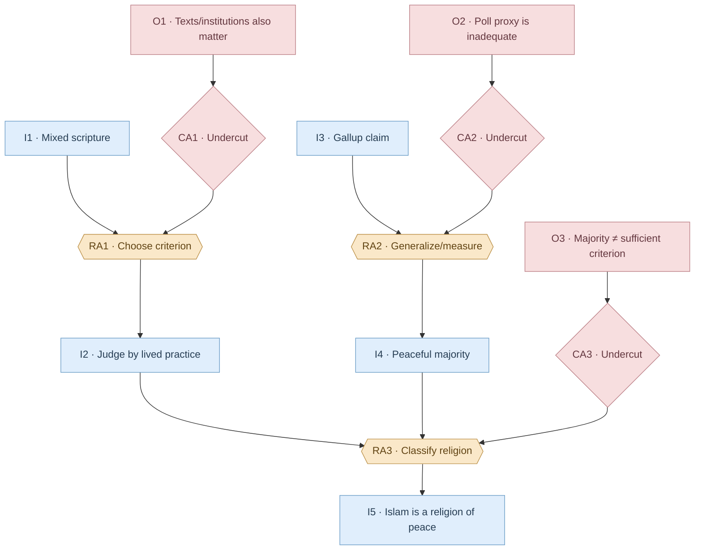

# ZK1 — Is a religion defined by its followers?

> [!abstract] Central issue
> Khan proposes judging the character of Islam chiefly by how Muslims **interpret and practise** it. Her survey-based claim about the peaceful majority then supports the motion. The central question is whether **followers' predominant practice is a sufficient or privileged criterion for classifying a religion**.

## 0. Conventions and boundaries

- **[Q] Quoted:** Khan's words, taken from the supplied speaker-labelled transcript (Speaker D, opening statement). Short excerpts preserve wording; ellipses indicate omission.
- **[R] Reconstructed:** a charitable attempt to make her inference explicit. Not necessarily a premise she consciously endorsed.
- **[O] Objection:** the analyst's challenge, not a statement by Khan.
- **[E] Evidence check:** information checked against an external source.
- **Status:** `stated`, `implicit`, `contested`, `not established`, or `to verify`.

**Scope:** This note studies Khan's *opening argument about how to define the religion*. Her distinct subsequent argument that violent extremism is driven by **politics rather than piety** should be analyzed as `[[ZK2]]`, then linked to this note. The present note does not itself resolve whether Islam is a religion of peace.

## 1. Source text and annotation

> [!quote] Zeba Khan — opening statement, selected excerpts
> **[Q1]** "the Quran and the Hadith have verses in them that point to peace and justice and love. But there are other verses that are violence, are about violence and about violence against specific people."
>
> **[Q2]** "The only way to answer that question is, is to take an honest look at the people who practice the faith and how they interpret it."
>
> **[Q3]** "According to Gallup's groundbreaking study on what a billion Muslims think, 93% of Muslims around the world are peaceful, mainstream Muslims. 7% are what Gallup terms as politically radicalized."

> [!note] Margin comments
> - **Q1:** Acknowledges textual plurality. This is a stated description of scripture, not proof that all readings are equally credible.
> - **Q2:** Moves from *the texts are mixed* to *followers' interpretations and lives should decide*. The phrase **"the only way"** is a strong and undefended exclusivity claim.
> - **Q3:** Supplies a quantitative premise, but **"politically radicalized" is not the measured opposite of "peaceful"**. See §7.
> - **Unspoken bridge:** Even if most Muslims live peacefully, why does that establish a property of *Islam* rather than a property of *its adherents*?

## 2. Standard form — two linked arguments

### Argument A: Choice of interpretive criterion

1. **P1 [Q/R, interpretive]:** Islamic scripture contains passages associated with peace and with violence.
2. **P2 [R, implicit]:** <span style="background:#b1ffff">Scripture containing apparently divergent messages does not, by itself, settle how to characterize the religion overall. <b></b></span>
3. **P3 [Q/R, methodological]:** We should therefore assess how people interpret and practise the religion.
4. **C-A [R]:** The religion's lived interpretation/practice is the appropriate basis for answering whether Islam is a religion of peace.

**Gap A:** P1 and P2 allow *examining* lived practice, but do not establish that it is **the only** or **best** method. Text, theology, institutions and historical consequences remain possible alternatives.

### Argument B: Applying that criterion

1. **P4 [Q, empirical claim]:** According to Khan, a Gallup study identifies 93% of Muslims as peaceful/mainstream and 7% as politically radicalized.
2. **P5 [R, implicit]:** This finding accurately represents the general character of Muslim belief and/or behavior.
3. **P6 [R, implicit, definitional]:** If the overwhelming majority of a religion's adherents practise peacefully, it is reasonable to characterize the religion as one of peace.
4. **C-B [Q/R]:** Islam is a religion of peace.

**Gap B1:** The Gallup category does not directly measure general peaceful conduct.

**Gap B2:** Even valid prevalence data do not by themselves prove P6, nor do they establish **that religion caused peaceful conduct**.

> [!important] Dependency
> **Argument B requires Argument A's proposed evaluative criterion.** Khan's central argument therefore has a *methodological/definitional hinge*, not just a numerical premise.

## 3. Toulmin reconstruction <span style="background:#b1ffff">(not sure)</span>

| Component                | ZK1 interpretation                                                                                                                                             | Status / comment                                                                                        |
| ------------------------ | -------------------------------------------------------------------------------------------------------------------------------------------------------------- | ------------------------------------------------------------------------------------------------------- |
| **Claim**                | Islam is a religion of peace.                                                                                                                                  | Stated motion defended.                                                                                 |
| **Grounds / data**       | Quran and Hadith contain divergent passages; Khan cites Gallup and examples of peaceful Muslims.                                                               | Source claims; survey interpretation needs checking.                                                    |
| **Warrant W1**           | The character of a religion should primarily be inferred from how its followers interpret and practise it.                                                     | **Implicit and disputed.**                                                                              |
| **Warrant W2**           | Predominantly peaceful adherents justify classifying the religion as peaceful.                                                                                 | **Implicit and disputed.**                                                                              |
| **Backing**              | Diversity of Muslim interpretations and Khan's family/community examples may help motivate W1; Gallup supports the empirical claim, **not W1 or W2 directly**. | Insufficient as a general defense of the warrants.                                                      |
| **Qualifier**            | Khan asserts the proposition strongly; a more defensible version might say *predominantly peaceful in contemporary practice, under a specified definition*.    | Proposed repair, not Khan's explicit qualifier.                                                         |
| **Rebuttal / exception** | Violent minorities exist and some interpretations endorse violence.                                                                                            | Acknowledged by Khan, but no explicit exception rule specifying when these would defeat her conclusion. |

**Toulmin's distinctive contribution:** Two opponents can agree that most Muslims are peaceful yet disagree about **W1 and W2**. The dispute need not be about the prevalence statistic.

> [!important] Lui's Note
> Not totally sure about the ChatGPT generated "**rebuttal**", or that is part of dispute in **W1**.
## 4. AIF-inspired representation

### Node register

| ID      | Kind     | Contents                                                                                                                                   |
| ------- | -------- | ------------------------------------------------------------------------------------------------------------------------------------------ |
| I1      | I-node   | Scripture contains both peaceful and violent passages [stated].                                                                            |
| I2      | I-node   | The best/only criterion is adherents' lived interpretation [reconstructed from stated Q2].                                                 |
| I3      | I-node   | Gallup supposedly establishes that 93% are peaceful/mainstream [Khan's stated report].                                                     |
| I4      | I-node   | Most contemporary Muslims are peaceful in relevant practice [Khan's intended empirical takeaway, **not independently established by I3**]. |
| I5      | I-node   | Islam is a religion of peace [claim].                                                                                                      |
| O1      | I-node   | Theological texts and institutions may independently determine a religion's character [analyst objection].                                 |
| O2      | I-node   | The survey classification does not directly measure general peaceful behavior [evidence objection].                                        |
| O3      | I-node   | A peaceful majority does not, without a classification rule, settle a religion's character [inference objection].                          |
| RA1     | RA-node  | Move from mixed texts to privileging lived practice; **interpretive-method selection**, custom label.                                      |
| RA2     | RA-node  | Infer population peacefulness from poll; **statistical generalization / operationalization**.                                              |
| RA3     | RA-node  | Infer the religion's overall character from prevalent adherent behavior; **defeasible classification**, custom label.                      |
| CA1–CA3 | CA-nodes | Objections aimed at **specific inferences**, not automatically at their conclusions.                                                       |



**AIF note:** This is a simplified *AIF-inspired* graph, not a validated AIF serialization. In AIF, attacks on an **RA-node** can represent *undercutting* the inference; a conflict with an **I-node** would target the proposition instead. No PA-node is needed until we explicitly represent a preference between competing interpretations/arguments.

> [!important] Lui's Note
> Don't quite agree with this figure.
## 5. Proposition and inference classification

### Propositions / premises

| ID | Proposition type | Basis / evidence | Status |
|---|---|---|---|
| P1 / I1 | Textual-descriptive | Khan's characterization of scripture | Stated; independent textual audit pending |
| P2 | Interpretive / epistemological | Apparent diversity of passages | Reconstructed; plausible, not sufficient |
| P3 / I2 | Methodological + normative | Priority of lived practice | Stated as a recommendation; **unjustified exclusivity** |
| P4 / I3 | Empirical, source-based | Gallup | Stated; measure mischaracterized if treated as direct peace rate |
| P5 / I4 | Empirical generalization | Poll as proxy for practice | Contested measurement/inference |
| P6 | Definitional / evaluative | How to assign the category “religion of peace” | Reconstructed; contested |
| I5 | Evaluative conclusion | Combined inferences | Depends on criteria and evidence |

### Inferences / Walton-compatible critical questions

| RA-node | General reasoning | Scheme label | Critical questions |
|---|---|---|---|
| RA1 | Defeasible interpretive reasoning | **Custom:** selection of evaluative criterion (not a named canonical Walton scheme) | Why prioritize practice? What alternatives exist? What would make this criterion appropriate? |
| RA2 | Inductive / statistical reasoning | Statistical generalization; with an argument from reported study results | Does the operational definition measure the intended construct? Is the sample representative? Does the statistic describe attitudes, actions, or both? |
| RA3 | Defeasible classificatory reasoning | **Custom:** classification from predominant practice | What definition/threshold is used? Can opposing features coexist? Are exceptional harms relevant? |

Walton's schemes offer **critical questions**, but **not every inference must be forced into an off-the-shelf Walton label**. The broad categories deductive/inductive/abductive and specific schemes are not always a clean hierarchy.

## 6. Objection register (one target at a time)

| ID | Objection / question | Target | Kind | What would answer it? |
|---|---|---|---|---|
| O1 | If the texts are mixed, why can't the answer be “both”, “neither”, or “mixed”? | RA3; definition of I5 | Alternative classification | State whether “religion of peace” means exclusive pacifism, dominant tendency, or normative commitment. |
| O2 | Why should ordinary followers count more than theologians, clergy, or canonical texts? | RA1 | Undercutter / selection criterion | Defend the chosen authority or weighting rule; consider an explicit plural-source definition. |
| O3 | Muslims' actions are influenced by politics, income, culture, law, etc. | RA2 **if measuring religion's influence**; RA3 if inferring essence | Confounding / scope | Distinguish *describing Muslim behavior* from *estimating Islam's causal influence*. |
| O4 | Does the answer vary across regions and periods? Should a religion be invariant across them? | Definition + RA3 | Scope / time index | Specify whether character is timeless doctrine or time-indexed lived practice. Invariance is an optional criterion, not a given fact. |
| O5 | Should the distribution be summarized by prevalence, mean, median, a tail percentile or extreme cases? | RA3 | Aggregation / value choice | Agree on the question and loss function: representative description versus worst-case harm. |
| O6 | Could the group be peaceful on average yet still support important violent religious norms? | RA2, RA3 | Construct validity / coexistence | Use multidimensional measures, not a single “peace ↔ violence” score. |
| O7 | Gallup's 93% are not directly measured as peaceful practitioners. | RA2 | Evidence/operationalization | Examine survey questions, sample, weighting, definitions and behavioral measures. |

> [!warning] Don't overclaim objections
> These challenges demonstrate **unresolved argumentative work**, not necessarily that Khan's conclusion is false. In particular, the existence of violent texts does not logically negate a *predominantly peaceful in practice* claim; it challenges the choice of definition.

### Your distribution analogy, refined

Your statistical analogy is useful, but “93%” is a **proportion after categorization**, not a mean on a valid peace-to-violence scale. Before computing any mean, minimum, or distribution, we would need to define the outcome construct and its measurement.

- For **describing ordinary practice**, prevalence/median may be relevant.
- For **protecting people against severe abuses**, the upper tail of violence and the institutions enabling it may matter much more.
- For **assessing doctrinal consistency**, proportions of followers may be beside the point; scripture, jurisprudence, and interpretive authority become relevant.
- For **estimating religion's causal contribution**, none of these raw summaries suffices without dealing with confounders.

An extreme perpetrator need not define a religion's typical adherent; conversely, an overwhelming peaceful majority does not by itself explain away systematic harmful teachings or institutions. These are **different target questions**, not competing estimators of one obvious quantity.

## 7. Evidence and fact-check layer

| Claim | Assessment | Reason |
|---|---|---|
| Khan cited a Gallup 93%/7% division. | **Verified as what Khan said.** | Supplied transcript, Speaker D opening. |
| Gallup identified 7% as “politically radicalized.” | **Broadly supported, with an important qualification.** | Gallup used survey responses, including saying 9/11 was **completely justified** and holding an unfavorable view of the US. This is an attitudinal classification. |
| Therefore 93% of Muslims are peaceful people in their conduct. | **Not established by this statistic.** | Not belonging to the specific 7% category does not measure all kinds of violence, all behavior, or all doctrinal positions. |
| Political grievances rather than religiosity explain the difference. | **Partially relevant, not a causal identification.** | Gallup reported little difference in religious attendance/importance across its categories. This does not establish that theology has *no* causal role. Analyze separately as `[[ZK2]]`. |
| Quran/Hadith have peaceful and violent passages. | **Attributed to Khan; not fully independently audited here.** | Requires choosing passages, translations, chronology and interpretive context to assess independently. |

**Checked sources:**

1. [Gallup, “What Makes a Radical?” (13 March 2008)](https://news.gallup.com/poll/104941/What-Makes-Radical.aspx), excerpt from *Who Speaks for Islam?*; describes the criteria behind the 7% label.
2. [Gallup, “Framing the War on Terror”](https://news.gallup.com/poll/28678/framing-war-terror.aspx); discusses differences between political attitudes and measures of religiosity.

**Evidence still needed:** original questionnaire, sampling and country coverage for the 7% subgroup; cross-national/temporal attitudes toward specific violence; behavioral and institutional indicators; textual and legal interpretation studies. A contemporary comparative analysis would also need newer sources, since Gallup's figures are historical.

## 8. Logic and fallacy audit (conditional, not verdicts)

| Potential issue | Where | Interpretation |
|---|---|---|
| **Undeclared definition / equivocation** | “Islam,” “peaceful,” “religion of peace” | The conclusion shifts between adherent behavior, religious teachings, and religion's identity unless terms are fixed. |
| **Unsupported exclusivity** | “The only way” | Alternative valid methods are not excluded by evidence that scripture contains divergent passages. This *may* create a false choice if other methods are ruled out. |
| **Overextension of survey evidence** | 93% → peaceful majority | The operational measure and the intended construct are not identical. |
| **Composition / aggregate-to-property leap** | peaceful Muslims → peaceful Islam | A possible objection **only if** the chosen definition of religion does not legitimately depend on adherents' predominant behavior. Not automatically a fallacy. |
| **Confusing description with causation** | peaceful adherents → religion promotes peace | The stronger causal claim requires separate evidence; Khan's immediate conclusion can be interpreted as classificatory instead. |
| **Appeal to popularity** | “majority” | Not inherently fallacious for describing a population. Would be problematic if majority practice alone were used to prove theological truth. |

## 9. Rhetorical layer

| Device | Transcript example / context | Possible function |
|---|---|---|
| Personal testimony / ethos | Her family, mosque, Jewish schooling | Establishes credibility as a practising Muslim and vivid counterexamples to stereotype. |
| Statistical appeal / logos | Gallup's 93% / 7% | Gives numerical authority to the representativeness claim. |
| Framing | “The only way” | Narrows what evidence audience treats as relevant. |
| Representative exemplars | Peaceful Muslim individuals and communities | Makes the majority visible and emotionally salient. |
| Moral pressure in voting | Suggests voting against the motion endorses extremists' version | Connects an empirical/definitional vote to social solidarity; this consequence does not logically follow by itself. |

Rhetoric is not necessarily manipulation. Record **what the move does** before judging its fairness.

## 10. Implicit values and contested priorities

- **Pluralism and respect for self-identification:** Muslims should be able to contribute to defining their own faith.
- **Fairness to the peaceful majority:** A violent minority should not automatically define everyone else.
- **Protection from stereotyping:** Avoid inferring characteristics of individuals from a group label.
- **Religious interpretive autonomy:** Lay believers' lived interpretations can be legitimate rather than automatically subordinated to clergy.
- **Countervalue / concern raised by critics:** Fidelity to the texts, accountability for institutional harms, and attention to people who experience coercion under religious authority.

**Value conflict to model:** representativeness and protection against collective stigma **versus** doctrinal accountability and protection against minority harms. Neither set of values decides the descriptive motion by itself.

> [!important] Lui's Note
> Not sure whether these should be classified as core values.
## 11. Alternative interpretations and what would settle them

| Target question / meaning of “religion of peace”                                    | Suitable assessment                            | What would support or challenge it?                                                              |
| ----------------------------------------------------------------------------------- | ---------------------------------------------- | ------------------------------------------------------------------------------------------------ |
| **Sociological:** most adherents oppose illegitimate violence                       | Population surveys and behavior by region/time | Direct measures of views and conduct; reliable sampling; specify “illegitimate violence.”        |
| **Textual-theological:** core teachings require or forbid violence                  | Scripture and interpretive traditions          | Full contextual analysis, norms of interpretation, disagreements about authority and abrogation. |
| **Institutional:** religious institutions typically foster peace                    | Laws, institutional practices, social outcomes | Comparative case studies with attention to political contexts.                                   |
| **Causal:** following Islam makes an otherwise comparable person more/less peaceful | Causal/social-scientific research              | Carefully operationalized outcomes and controls; avoid treating association as causation.        |
| **Pluralist:** Islam contains peaceful and violent strands                          | Multiple traditions and their influence        | Evidence of coexistence, proportions, influence, and change through time.                        |

These interpretations can yield different answers **without any necessary contradiction**, because they ask different questions.

## 12. How to strengthen ZK1 charitably

**Possible defensible revision (not Khan's exact argument):**

> “A religion has textual and institutional dimensions, but its contemporary character also depends on how believers interpret and live it. To the extent that representative evidence shows that most Muslims reject attacks on civilians, it is misleading to characterize contemporary Islam as uniformly violent. This is not proof that all Islamic teachings are peaceful, nor that Islam uniquely causes peaceful behavior.”

Why it is stronger:

1. Drops **“the only way”** and allows multiple dimensions.
2. Replaces the vague 93% = peaceful inference with **specific behavior/attitude questions**, to be measured accurately.
3. Avoids inferring **causation** from a group's description.
4. Replaces an exclusive binary label with a bounded **time-, context-, and dimension-specific** claim.

**What Khan would still need to establish for the *original* motion:** a defensible definition of “religion of peace,” a criterion for weighing followers against texts and institutions, valid evidence for that definition, and a rationale for applying the label despite significant exceptions.

## 13. Provisional assessment and next questions

> [!summary] Current assessment
> - **Most important open premise:** W1 — Why should lived practice take priority over textual/institutional interpretations?
> - **Most important measurement issue:** Gallup's attitude-based classification is not a direct 93% peacefulness rate.
> - **Most important conceptual distinction:** Is the motion descriptive, theological, institutional, or causal?
> - **Provisional verdict:** Khan provides a plausible *reason to include lived Muslim practice* in assessing the motion, but does not yet establish that this is the **exclusive criterion** or that the cited survey is sufficient to support her unqualified conclusion.

**Unresolved checkpoints for a collaborative argument database:**

- [ ] Agree on an operational definition of “religion of peace.”
- [ ] Decide whether the claim is universal or indexed by region and period.
- [ ] Set the weighting rule for texts, scholars, institutions, and ordinary practitioners.
- [ ] Retrieve the original Gallup questionnaire/methodology and reconcile the published 7% definition.
- [ ] Separate attitude, conduct, institutional power, and religion's causal influence.
- [ ] Link to `[[ZK2]]`: politics versus religiosity as explanations of extremism.
- [ ] Link to opposing arguments that challenge textual authority, contextualization, and representation.

---

## 14. Reusable schema for future arguments

```yaml
argument_id: ZK1
source_spans: [Q1, Q2, Q3]
claim: I5
premises: [I1, I3]
reconstructed_assumptions: [P2, P5, P6]
inferences:
  - {id: RA1, category: interpretive, scheme: custom_method_selection}
  - {id: RA2, category: inductive, scheme: statistical_generalization}
  - {id: RA3, category: defeasible, scheme: custom_predominant_practice_classification}
challenges:
  - {id: O1, target: RA1, relation: undercut}
  - {id: O2, target: RA2, relation: undercut}
  - {id: O3, target: RA3, relation: undercut}
evidence:
  - {id: E1, source: gallup_2008, linked_claim: I3, assessment: requires_narrower_interpretation}
conclusion_status: unresolved
```

This YAML block is an **illustrative application schema**, **not** an AIF or AIFdb-compatible export. The AIF-style graph above is an analytical visualization; a formal export would require a precise serialization and consistent node/edge ontology.
